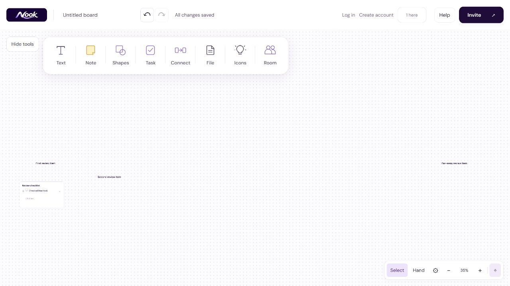

# Nook pre-drawing review — 0.9.11

Reviewed November 11, 2026. Review only: no application fixes, drawing implementation, or publication were performed. Browser interactions used a separate temporary review board; existing user boards were preserved.

Follow-up: findings 1 and 2 were subsequently fixed at the user's request on November 11. Focused browser checks, 206 automated tests, and the multiplayer smoke check passed. The original findings below remain as review history; launch preparation findings 3 and 4 remain pending. See CHANGELOG.md for the follow-up.

## Findings

### 1. Fix before drawing: modifier-clicking written text loses selection

Browser reproduction: create two separate text items, finish editing, click the first item's words, then Ctrl-click the second item's words. The resulting selected-element count was zero instead of two. Dragging a marquee and grouping the two items worked, so this is specifically a text-editing/selection interaction.

The shared content pointer handler starts editing before the canvas modifier handler runs. Starting editing changes the selection, after which the modifier handler toggles the new selection off. See `priv/static/assets/canvas-ui.mjs:125` and `:300`. Other item types share this handler, but the direct reproduction in this review used plain text. Give selection modifiers priority over entering the editor, and verify Ctrl/Cmd/Shift behavior on text, notes, shapes, and task titles.

### 2. Fix before drawing: reload forgets the camera

Browser reproduction: pan 2,700 pixels away from the origin, create a text item, finish editing, and reload. The world transform reset from `translate(-2700px, 0px) scale(1)` to `translate(0px, 0px) scale(1)`. The distant item remained saved but was outside the viewport and hidden by virtualization. “Show everything” recovered it successfully.

The initial camera is hard-coded in `priv/static/assets/canvas-ui.mjs:16`. Remember the camera locally per board and validate stored coordinates/zoom. Provide a sensible fit fallback when no saved view exists. This is apparent missing content, not observed data loss.

### 3. Address before public access: abuse and storage limits

The source review found no application-level rate limiter for guest board creation, authentication/email attempts, or board operations/previews. Cursor broadcasts already have a server throttle; individual HTTP/WebSocket payloads and element counts also have limits. Those protections should remain.

Add bounded request/message rates and an aggregate board/file storage budget. Existing limits permit up to 2,000 elements, with individual element and batch payload bounds near 1.5 MB; they do not establish a small total board size. Inline file data can therefore make full board snapshots large. Review the LiveView create event as well as HTTP and channel entry points so limiting only one route cannot be bypassed.

Relevant files: `lib/nook_web/live/board_live.ex`, `lib/nook_web/router.ex`, `lib/nook_web/user_socket.ex`, `lib/nook/boards.ex`, and `lib/nook_web/endpoint.ex`.

### 4. Measure before public access: large boards and multiple rooms

All boards currently pass through one named GenServer. Storage operations construct complete board snapshots and successful channel operations return a full snapshot. This is a scaling risk inferred from the implementation, not a measured production failure. The real multiplayer smoke checks passed, but they are not a production capacity benchmark.

Benchmark a realistically busy board and several simultaneous rooms before choosing whether to change coordination or snapshot delivery. Drawing must use bounded live previews and save a completed, simplified stroke as one undoable action; persisting every pointer sample through the existing path would magnify the cost.

Relevant files: `lib/nook/boards.ex:3`, `lib/nook/boards/store.ex:55`, and `lib/nook_web/user_socket.ex:79`.

## Verification completed in this review

- 155 ExUnit tests and 49 JavaScript tests passed: 204 automated tests total.
- Real HTTP/WebSocket smoke checks passed, including concurrent visitors, independent edits, cursor traffic, room admission, access revocation, conflicts, reconnection/offline recovery, idempotent replay, and collaboration-safe Undo/Redo.
- The legacy verification script confirmed that all five original boards retain their original fields and titles.
- Formatting checks passed.
- A local 0.9.11 production release built and boot verification passed with secure cookies, HTTPS-origin configuration, no development inbox, database connectivity, and HTTP disabled.
- Browser checks confirmed editable task titles and persisted task content, marquee/grouping, the two usability findings above, and successful recovery with Show everything.

The production boot check used dummy SMTP and sent no email. Real email delivery, the actual hosting/proxy/domain configuration, cross-device accessibility, production load, and a fresh backup/restore drill remain separate checks. This review is not a full security or accessibility audit. A Windows release build is not a deployable artifact for a different operating system.

## Recommended order

1. Fix modifier selection and remember the board camera, with focused regression checks.
2. Define drawing input, preview, stroke-size, storage, and undo rules; add the public-access bounds.
3. Implement a small drawing mode that coexists with typing, selection, and panning. Save each completed stroke as one action.
4. Run large-board/multiple-room measurements and private staging checks, including real email, WebSocket proxying, backups/restoration, and two-person testing on different devices.
5. Polish and publish after the user approves the result. Nothing was published during this review.

## Browser evidence

The image shows the isolated review board after Show everything recovered the distant saved item.

